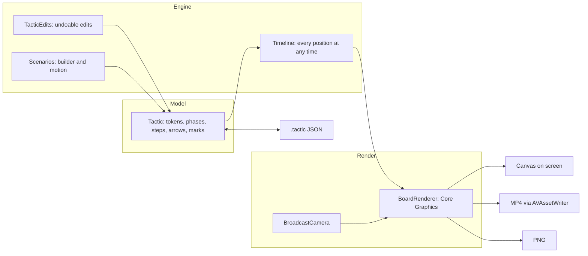

# CenterSpot

**Draw the move, not just the shape.** An iPhone and iPad app that turns a formation into a step-by-step animated move, then exports it as a vertical video, an image or an open `.tactic` file.

<!-- clip: the 9:16 demo video made in the app goes here -->

A one-week portfolio build by [Chime Ekpendu](https://chimexd.work), made with Claude Code. Case study: [`docs/CASE-STUDY.md`](docs/CASE-STUDY.md). Design system: [centerspot-design-system.vercel.app](https://centerspot-design-system.vercel.app).

## What it does

People who explain football tactics (FM and EA FC players, grassroots coaches, football creators) share screenshots, text codes and Canva templates. A screenshot shows a shape; it can't show a move. CenterSpot can.

- **Build a move in steps.** Pick a shape (18 eleven-a-side, 4 seven-a-side, 4 five-a-side), drag players, add steps, set each step's time. Tap a player to see its name, or its position (CDM, LB, ST) until it has one.
- **Draw runs, passes, dribbles and presses.** Straight or curved arrows. On iPad the Apple Pencil draws in Draw mode and moves players like a finger otherwise. Zones, shape lines and glows mark space.
- **Play it.** A scrubber, half speed, and a Broadcast camera that tilts the pitch like a TV shot and follows the ball. With Reduce Motion it steps from position to position instead.
- **Start from a scenario.** 24 ready-made situations (team shapes, small-sided games, set pieces), each a 3–5 step move built from your own shape and shirt numbers. Attacking ends in a goal; defending ends with your side winning the ball.
- **Export it.** MP4 in 9:16, 1:1 or 16:9, a PNG of a step, or a `.tactic` file to send by AirDrop, Files or WhatsApp that opens as the exact board.
- **Accessible.** VoiceOver reads every player by number, role and place, and its actions move them. Text scales with Dynamic Type.

## Honest numbers

Export on an iPhone 14 Pro (Debug build), flat → Broadcast camera, from [`PROGRESS.md`](PROGRESS.md):

| Clip | 9:16 | 1:1 | 16:9 |
| --- | --- | --- | --- |
| Hero move, 5 steps (8 s) | 1.68 s, 1.33 MB → 2.37 s, 2.56 MB | 0.85 s, 0.69 MB → 1.52 s, 1.59 MB | 1.35 s, 0.83 MB → 2.23 s, 2.52 MB |
| Ten steps (15.7 s) | 2.98 s, 2.75 MB → 4.67 s, 5.83 MB | 1.64 s, 1.40 MB → 2.96 s, 3.55 MB | 2.60 s, 1.70 MB → 4.36 s, 5.85 MB |

Every clip renders in less than a third of its own length and stays under 8 MB per 15 s. Broadcast takes about 1.5× the time and twice the size: a moving camera compresses less.

- 482 unit test functions (Swift Testing) and 21 UI tests (XCUITest). Every commit must pass the full unit suite and an iOS 26 iPad build.
- About 13,300 lines of Swift in the app and 9,400 in tests. No third-party packages.
- Still to confirm on the devices: several features wait on the on-device checklist ([`docs/features.json`](docs/features.json)).

## How it's built



- **One renderer.** `BoardRenderer` draws into a `CGContext`. The screen calls it inside a SwiftUI `Canvas`; export calls it offscreen, frame by frame. What you see is what you export, and a parity test holds the two together.
- **The camera is maths, not a 3D engine.** `BroadcastCamera` is a perspective projection: discs and numbers stay upright, and the camera never pans past a touchline.
- **PencilKit only captures.** Strokes become CenterSpot's own path model; nothing renders a `PKDrawing`.
- **An open format.** A `.tactic` file is small JSON that any tool can read and write: [`docs/FORMAT.md`](docs/FORMAT.md). Imports are validated and fuzz-tested.
- **The spec runs.** The scenario engine was designed as a playable web mockup (`mockup/scenario-motion.js`). Its output is the fixture the Swift port must match: 158 moves, every position within 0.0015 of the pitch.
- **Swift 6** with strict concurrency, SwiftUI, iOS and iPadOS 26.0 or later.

```
CenterSpot/
  Model/      the tactic, tokens, steps, roles, scenarios
  Engine/     timeline, edits, placement, scenario builder and motion
  Render/     BoardRenderer, BroadcastCamera, token and arrow drawing
  Services/   library, .tactic format, presets, video and image export
  Features/   Board, Draw, Steps, Playback, Formation, Inspector, Export, Library, Onboarding
presets/      formations, roles and scenario scripts (JSON)
mockup/       the design mockups and the scenario spec
docs/         plan, spec, format, decisions log, case study
```

Every product and architecture decision is in [`docs/DECISIONS.md`](docs/DECISIONS.md) (D-01 to D-98), with the reason and who made it.

## Build

Requires Xcode 27 and [XcodeGen](https://github.com/yonaskolb/XcodeGen).

```bash
cp Config/Signing.local.xcconfig.example Config/Signing.local.xcconfig   # set your Team ID
xcodegen generate
open CenterSpot.xcodeproj
```

Run the tests:

```bash
xcodebuild -scheme CenterSpot -destination 'platform=iOS Simulator,name=iPhone 18 Pro' test
xcodebuild -scheme CenterSpotUITests -destination 'platform=iOS Simulator,name=iPhone 18 Pro' test
```

## Licence

Code: MIT. No club badges, league names, real kits or game assets are included or used.
