<p align="center">
  <picture>
    <source media="(prefers-color-scheme: dark)" srcset="docs/readme/centerspot-mark-dark.svg">
    <source media="(prefers-color-scheme: light)" srcset="docs/readme/centerspot-mark-light.svg">
    
  </picture>
</p>

<h1 align="center">CenterSpot</h1>

<p align="center">
  <b>Draw the move, not just the shape.</b><br>
  CenterSpot is an iPhone and iPad app for anyone who explains football tactics. Pick a shape, build a move<br>
  in steps, draw the runs and passes, play it back like a TV camera, and post it as a vertical video,<br>
  or send it as an open <code>.tactic</code> file that opens as the exact board on someone else's phone.
</p>

<p align="center">
  <a href="https://github.com/ChimeXXD/centerspot/actions/workflows/ci.yml"></a>
  <a href="LICENSE"></a>
  
  
  
  
</p>

<p align="center">
  <a href="https://chimexd.work/work/centerspot"><b>Case study</b></a> ·
  <a href="https://centerspot-design-system.vercel.app"><b>Design system</b></a> ·
  <a href="docs/FORMAT.md"><b>The .tactic format</b></a> ·
  <a href="docs/DECISIONS.md"><b>Decisions</b></a> ·
  <a href="docs/CASE-STUDY.md"><b>Build notes</b></a>
</p>

<p align="center">
  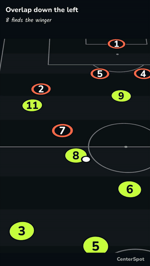
</p>

<p align="center"><sub>This clip is CenterSpot's own export: the 9:16 video the app makes, with its title band and step notes.</sub></p>

---

> [!NOTE]
> **CenterSpot is a private beta**, built in about a week (6 to 10 Nov 2026) as a portfolio project. There's no
> App Store release: build it yourself with a free Apple ID ([Get started](#get-started)). Free-signed builds run for
> 7 days.

**Contents:** [Why CenterSpot](#why-centerspot) · [What it does](#what-it-does) · [How it works](#how-it-works) ·
[Honest numbers](#honest-numbers) · [Design system](#design-system) · [Get started](#get-started) ·
[Quality gates](#quality-gates) · [Repository map](#repository-map) · [Docs](#docs) · [Privacy](#privacy) ·
[Status and roadmap](#status-and-roadmap) · [Known limitations](#known-limitations) · [Contributing](#contributing) ·
[Credits and licence](#credits-and-licence)

## Why CenterSpot

**A screenshot shows where everyone stands. It can't show who runs where, and when.** Football Manager and EA FC
players, Sunday-league coaches and football creators explain tactics with screenshots, text codes and Canva templates.
FM Scout's FM26 tactics index has about 147 shared tactics, the top one downloaded 141,968 times; Canva lists 15,275
football templates. The demand to *show* a tactic is there.

The apps that animate a move are built for paid club staff: TacticalPad is $39.99 a year with no 9:16 preset, and
Tactics Manager caps MP4 exports at five on its £79.99 plan. Lineup builders stop at a still picture.

**CenterSpot puts four things in one app** ([D-02](docs/DECISIONS.md)):

1. **Keyframe steps.** A move is a list of steps; the app eases everyone from one to the next.
2. **A one-tap 9:16 video**, small enough for a group chat on mobile data: under 8 MB for 15 seconds.
3. **Runs drawn with the Apple Pencil** on iPad, or a finger on iPhone.
4. **An open file format**, so a tactic isn't locked inside one app.

It was built first for a coach in Lagos, Nigeria, on an iPhone, and works the same anywhere.

## What it does

### Build a move in steps

Pick a shape (18 eleven-a-side, 4 seven-a-side and 4 five-a-side), drag players, add a step, drag again. Tap a player
to see its name, or its position as a coach writes it (CDM, LB, ST) until it has one.

<p align="center">
  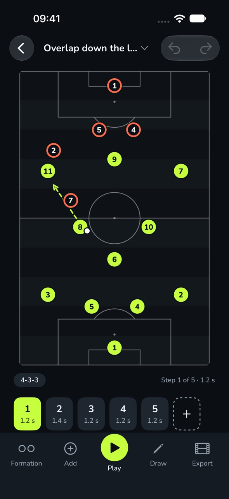
  &nbsp;
  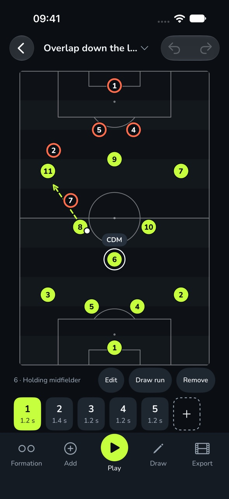
</p>

### Draw runs, passes, dribbles and presses

A run moves the player, a pass moves the ball, a dribble moves both. Lines are Straight or Curved; a curved one bends
from its middle dot. Zones, shape lines and glows mark space. On iPad the Pencil draws only in Draw mode and moves
players like a finger otherwise ([D-90](docs/DECISIONS.md)).

<p align="center">
  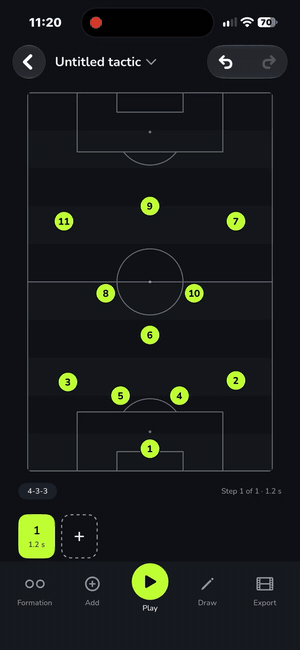
</p>

### Play it like a TV camera

Play has a scrubber, half speed, and a **Broadcast** camera that tilts the pitch like a TV shot and follows the ball.
The camera is a perspective projection inside the one renderer, so playback, scrubbing and export frame the same view
at the same moment. With Reduce Motion it steps from position to position instead.

<p align="center">
  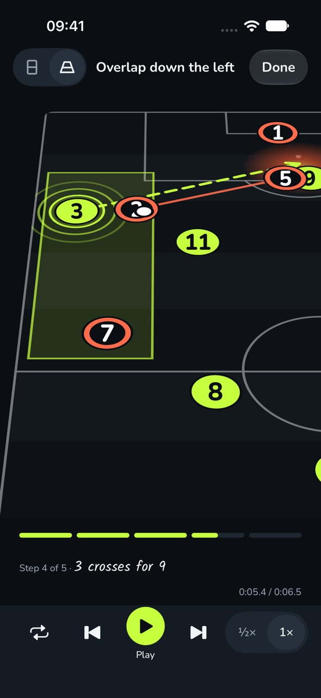
</p>

### Start from a scenario

24 ready-made situations on 11-a-side (18 on 7, 13 on 5): team shapes, small-sided games and set pieces, built from
your own shape and shirt numbers. By default a scenario sets up its starting position; switch on **Include the move**
for its 3 to 5 ready-made steps. Attacking moves end in a goal; defending moves end with your side winning the ball.

<p align="center">
  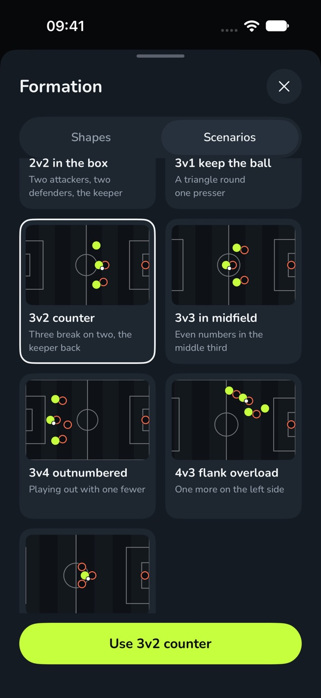
</p>

### Export it, or send the file

MP4 in 9:16, 1:1 or 16:9 (flat or Broadcast), a PNG of a step, or a `.tactic` file to send by AirDrop, Files or
WhatsApp that opens as the exact board. The size shows before you export.

<p align="center">
  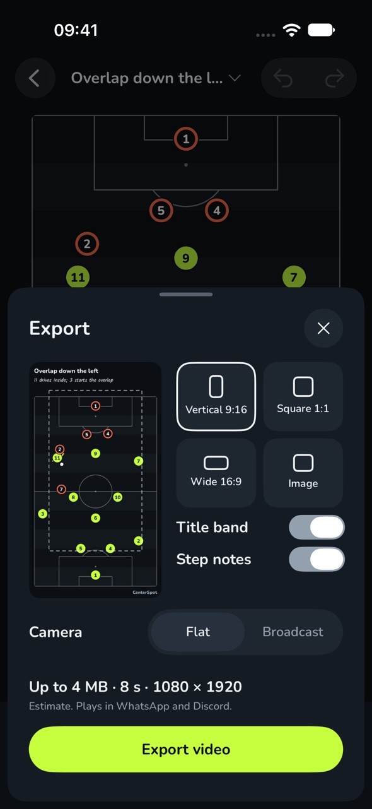
  &nbsp;
  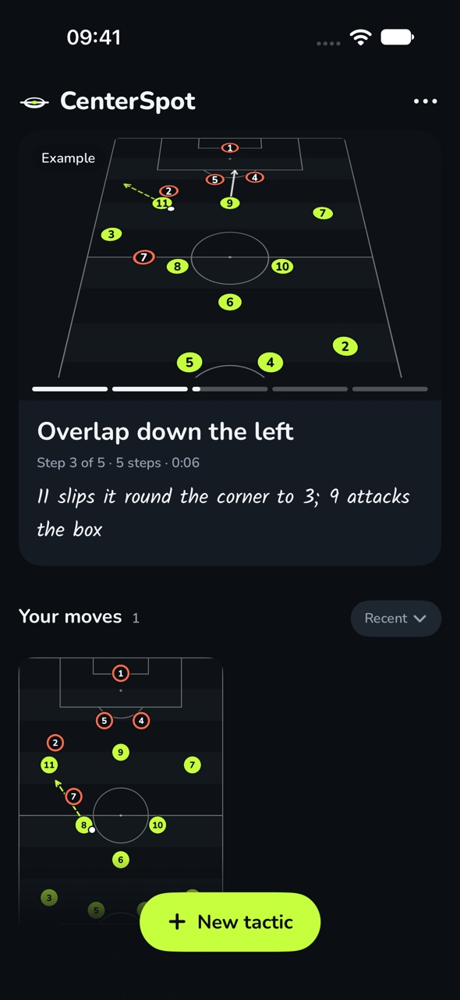
</p>

### The iPad's big board

In landscape the pitch fills the height and every step is listed beside it; tap a row to jump to it.

<p align="center">
  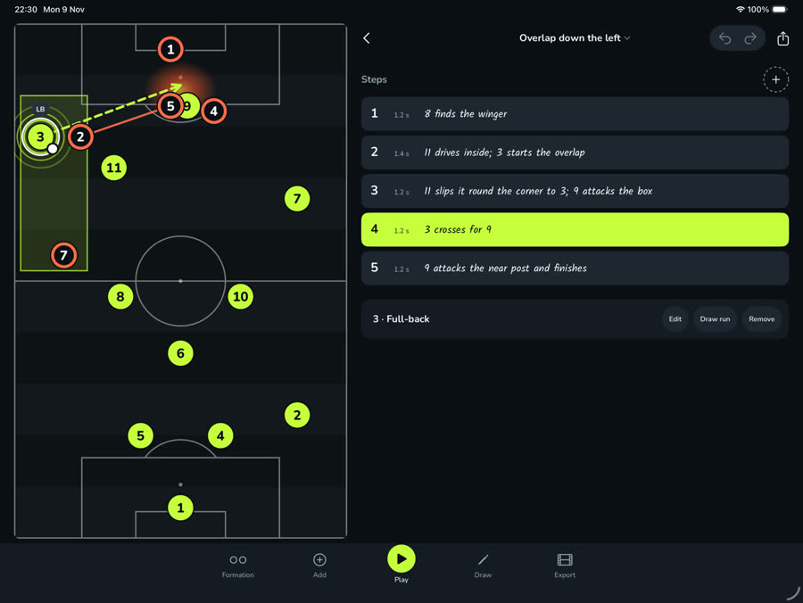
</p>

### Accessible by default

VoiceOver reads every player as "Number 9, striker, edge of the box, step 4 of 5", and its actions move them. Home and
away differ by shape as well as colour (discs and rings), text follows Dynamic Type, and Reduce Motion is respected.

## How it works

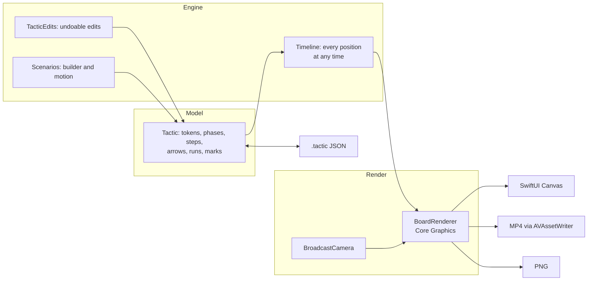

- **One renderer** ([D-07](docs/DECISIONS.md)). `BoardRenderer` draws into a `CGContext`: the screen calls it inside a
  SwiftUI `Canvas`, export calls it offscreen frame by frame. A parity test holds the two together: 99.5% of pixels
  within 16/255, and none more than 64/255 off.
- **The camera is maths, not a 3D engine** ([D-76](docs/DECISIONS.md), [D-95](docs/DECISIONS.md)). Discs and numbers
  stay upright, the camera never pans past a touchline, and its path is worked out from the move itself.
- **PencilKit only captures.** Strokes become CenterSpot's own path model; nothing renders a `PKDrawing`.
- **An open, validated format** ([FORMAT.md](docs/FORMAT.md)). A `.tactic` is small, versioned JSON. Bad files are
  refused or repaired by written rules; 6,437 fuzzed cases found 4 bugs, now fixed.
- **The scenario spec runs in a browser.** The rules were written first in `mockup/scenario-motion.js`; its output is
  the fixture the Swift port must match: 158 moves, every position within 0.0015 of the pitch.

## Honest numbers

Export on an iPhone 14 Pro (Debug build), flat → Broadcast, from [`PROGRESS.md`](PROGRESS.md):

| Clip | 9:16 | 1:1 | 16:9 |
| --- | --- | --- | --- |
| Example move, 5 steps (8 s) | 1.68 s, 1.33 MB → 2.37 s, 2.56 MB | 0.85 s, 0.69 MB → 1.52 s, 1.59 MB | 1.35 s, 0.83 MB → 2.23 s, 2.52 MB |
| Ten steps (15.7 s) | 2.98 s, 2.75 MB → 4.67 s, 5.83 MB | 1.64 s, 1.40 MB → 2.96 s, 3.55 MB | 2.60 s, 1.70 MB → 4.36 s, 5.85 MB |

Every clip renders in under a third of its own length and stays under 8 MB per 15 s. A moving camera compresses less,
so Broadcast takes about 1.5× the time and twice the size. Release builds and older phones weren't measured.

## Design system

<p align="center">
  <a href="https://centerspot-design-system.vercel.app">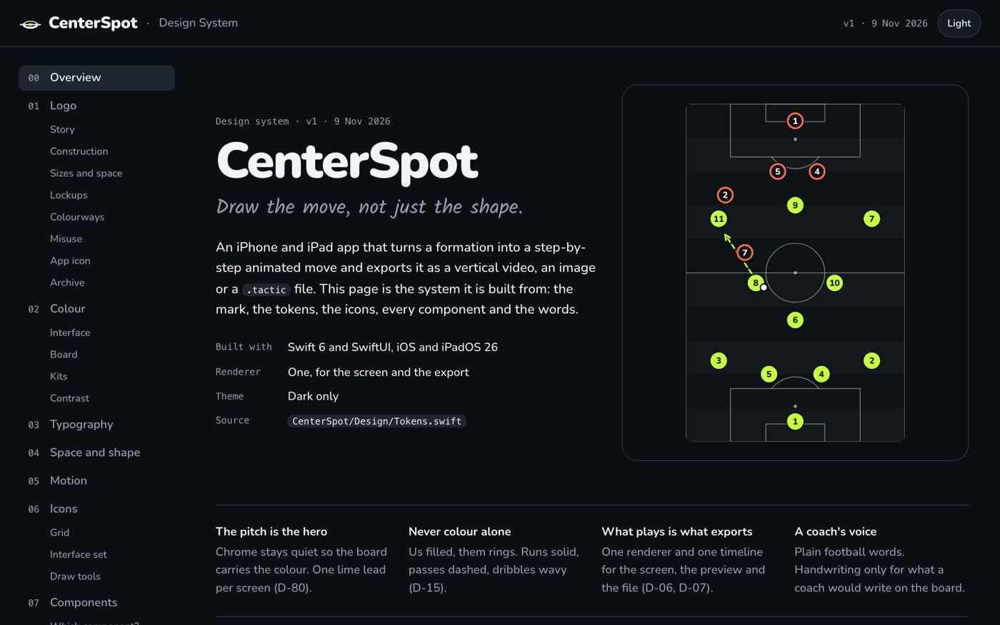</a>
</p>

**[centerspot-design-system.vercel.app](https://centerspot-design-system.vercel.app)**: the logo and its colourways,
colour, type, spacing, motion, the icon set, every component, and the scenarios playing live. It's built from the
app's own tokens (`CenterSpot/Design/Tokens.swift`) by `design-system/src/build.py`, and redeploys on every push.

## Get started

**You need** a Mac with Xcode 27 or later, [XcodeGen](https://github.com/yonaskolb/XcodeGen) (`brew install xcodegen`),
and, to run it on a device, a free Apple ID. There are no third-party packages.

```bash
git clone https://github.com/ChimeXXD/centerspot.git && cd centerspot
cp Config/Signing.local.xcconfig.example Config/Signing.local.xcconfig
# In Signing.local.xcconfig: your Team ID (Xcode › Settings › Accounts)
xcodegen generate
open CenterSpot.xcodeproj   # run the CenterSpot scheme on a simulator, your iPhone or your iPad
```

The first launch adds an example move, "Overlap down the left". Debug builds have launch options for demos and timing:
`-resetLibrary YES` starts from a clean library, `-seedLibrary N` adds N more moves, and `-exportBench` times every
export format and prints the results.

## Quality gates

| Check | What it proves |
| --- | --- |
| **483 unit tests** (Swift Testing) | The format and its import rules, the timeline, edits, drawn paths, the camera, the renderer's stacking and parity with export, scenarios against their spec, VoiceOver words |
| **21 UI tests** (XCUITest) | Real taps through the library, board, draw, play, export, scenarios and the iPad layout, on iPhone and iPad simulators |
| **Fuzzing** | 6,437 seeded malformed `.tactic` files are refused or repaired, never crash |
| **A commit gate** | No commit lands until an iOS 26 iPad build, the full unit suite and a naming check pass |
| **CI** ([GitHub Actions](https://github.com/ChimeXXD/centerspot/actions)) | Build and every unit test on macOS, on each push and pull request |

```bash
xcodebuild -scheme CenterSpot -destination 'platform=iOS Simulator,name=iPhone 17 Pro' test
xcodebuild -scheme CenterSpotUITests -destination 'platform=iOS Simulator,name=iPhone 17 Pro' test
```

## Repository map

```
CenterSpot/          the app
  Model/             the tactic, tokens, steps, roles, scenarios
  Engine/            timeline, edits, placement, scenario builder and motion
  Render/            BoardRenderer, BroadcastCamera, token and arrow drawing
  Services/          library, .tactic format, presets, video and image export
  Features/          Board, Draw, Steps, Playback, Formation, Inspector, Export, Library, Onboarding
  Design/            tokens, fonts (Nunito, Kalam)
presets/             formations, roles and scenario scripts (JSON)
examples/            the example move as a .tactic file
CenterSpotTests/     Swift Testing; Fixtures/ holds .tactic files and the scenario spec's output
CenterSpotUITests/   real-tap UI tests and screenshots
design-system/       the design system site (deployed on Vercel)
mockup/              the approved mockups and the scenario spec (playable in a browser)
docs/                plan, spec, format, decisions, research, build notes
```

## Docs

| File | What's in it |
| --- | --- |
| [`docs/CASE-STUDY.md`](docs/CASE-STUDY.md) | The story of the build: the problem, the decisions, what went wrong, the numbers |
| [`docs/FORMAT.md`](docs/FORMAT.md) | The `.tactic` format, versioned, with its import rules |
| [`docs/DECISIONS.md`](docs/DECISIONS.md) | Every product and architecture decision (D-01 to D-99), with its reason |
| [`docs/SPEC.md`](docs/SPEC.md) | Flows, screens, acceptance criteria |
| [`docs/PRD.md`](docs/PRD.md) | The original product brief, research and competitors, with sources |
| [`docs/PLAN.md`](docs/PLAN.md) | The one-week plan, day by day |
| [`PROGRESS.md`](PROGRESS.md) | The build log, with what was checked and measured |
| [`CLAUDE.md`](CLAUDE.md) | The rules the coding agent works to |

## Privacy

CenterSpot has no account, no analytics and no networking code: it never connects to the internet. Your moves are
`.tactic` files in the app's own folder, visible in Files, and leave your device only when you export or send them.

## Status and roadmap

**Private beta**, built in about a week as a portfolio project; not on the App Store. On 9 Nov 2026 a 16-item
checklist passed on an iPhone 14 Pro and an iPad Pro 13-inch (M4), and 29 of 35 planned features pass
([features.json](docs/features.json)).

Next, if it continues: sharing a tactic as a link or QR code (already defined in the format,
[D-36](docs/DECISIONS.md)), and the iPad's three-column view with the library, the board and an inspector side by side.

## Known limitations

- **Free signing:** builds made with a free Apple ID stop opening after 7 days; rebuild to renew.
- **Export timings** were measured on a Debug build on one iPhone 14 Pro; Release and older phones weren't measured.
- **Links and QR codes** aren't built yet; share the video or the `.tactic` file.
- **VoiceOver on iPad** hasn't been checked on a device (it has on iPhone).

## Contributing

Issues and pull requests are welcome. Run the unit tests first; each change should keep the screen and the export
drawing the same board. Product decisions live in [`docs/DECISIONS.md`](docs/DECISIONS.md): a change that reverses one
should say which.

## Credits and licence

- **Code:** [MIT](LICENSE).
- **Fonts:** [Nunito](CenterSpot/Design/Fonts/Nunito-OFL.txt) and [Kalam](CenterSpot/Design/Fonts/Kalam-OFL.txt), both
  under the SIL Open Font License.
- No club badges, league names, real kits or game assets are included or used.
- **Built by** [Chime](https://chimexd.work) with [Claude Code](https://claude.com/claude-code).
